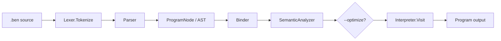

<div dir="rtl" align="right">

# معماری و راهنمای توسعهٔ Benita

<p align="center">
  
</p>

این سند مرجع توسعه‌دهنده برای وضعیت فعلی مخزن Benita است. Benita یک زبان آموزشی،
تفسیرشونده و مبتنی بر C# و .NET 8 است. هدف این صفحه توضیح دقیق ساختار مخزن، مرز
لایه‌ها، خط لولهٔ پردازش، مدل معنایی، runtime، کلاس‌های داخلی، REPL و روش اضافه‌کردن
قابلیت‌های جدید است؛ نه تکرار کامل آموزش زبان.

## فهرست مطالب

- [نمای کلی](#نمای-کلی)
- [ساختار مخزن](#ساختار-مخزن)
- [خط لولهٔ پردازش](#خط-لولهٔ-پردازش)
- [مرزهای معماری](#مرزهای-معماری)
- [نحو و مدل AST](#نحو-و-مدل-ast)
- [اتصال نام‌ها و تحلیل معنایی](#اتصال-نامها-و-تحلیل-معنایی)
- [مدل نوع و scope](#مدل-نوع-و-scope)
- [Runtime و مفسر](#runtime-و-مفسر)
- [کلاس‌های داخلی](#کلاسهای-داخلی)
- [CLI و REPL](#cli-و-repl)
- [Diagnostics و عیب‌یابی](#diagnostics-و-عیبیابی)
- [تست و CI](#تست-و-ci)
- [راهنمای تغییر کد](#راهنمای-تغییر-کد)
- [محدودیت‌ها و برنامهٔ آینده](#محدودیتها-و-برنامهٔ-آینده)

## نمای کلی

مسیر عادی اجرای یک فایل به شکل زیر است:

<div dir="ltr" align="left">



</div>

نکتهٔ مهم این است که پروژه «کامپایلر به کد ماشین» نیست. `CompilerClass` یک هماهنگ‌کننده
برای tokenize، parse، binding، تحلیل معنایی، بهینه‌سازی اختیاری و اجرای مستقیم AST است.
`Binder` در حال حاضر برای ساخت context نمادین و `BoundProgram` استفاده می‌شود، اما مفسر
مستقیماً AST را visit می‌کند و هنوز bound tree ورودی اجرای اصلی نیست.

## ساختار مخزن

| مسیر | مسئولیت فعلی |
| --- | --- |
| [`Benita/Benita.csproj`](../Benita/Benita.csproj:1) | پروژهٔ اجرایی .NET 8 و منبع نسخهٔ assembly |
| [`Benita/Application`](../Benita/Application) | ورودی CLI، نسخهٔ برنامه، و REPL |
| [`Benita/Compilation`](../Benita/Compilation) | Lexer، Parser، AST printer، Binder، Semantic Analyzer، optimizer و compiler facade |
| [`Benita/Syntax`](../Benita/Syntax) | tokenها، AST nodeها و قرارداد visitor |
| [`Benita/Semantics`](../Benita/Semantics) | symbolها، scopeها، type symbolها و قواعد assignability |
| [`Benita/Runtime`](../Benita/Runtime) | Interpreter، runtime context/environment، package instance، task و debugger |
| [`Benita/Runtime/BuiltIns`](../Benita/Runtime/BuiltIns) | تعریف و اجرای کلاس‌های داخلی و مقدارهای runtime |
| [`Benita/Diagnostics`](../Benita/Diagnostics) | exceptionها و گزارش خطاهای مرحله‌ای |
| [`BenitaTestProject`](../BenitaTestProject) | تست‌های MSTest واحد، integration، regression و اجرای مثال‌ها |
| [`Examples`](../Examples) | برنامه‌های نمونهٔ `.ben` و الگوریتم‌ها |
| [`docs/Grammar.txt`](Grammar.txt) | مرجع رسمی grammar |
| [`docs/Tutorial.MD`](Tutorial.MD) | آموزش زبان و مثال‌های نحوی |
| [`docs/Architecture.md`](Architecture.md) | تصمیم‌های معماری و قراردادهای داخلی |
| [`docs/BuiltInClasses.md`](BuiltInClasses.md) | راهنمای کامل افزودن built-in |
| [`docs/BuiltInClassCatalog.md`](BuiltInClassCatalog.md) | فهرست API کلاس‌های داخلی |
| [`editors/vscode-benita`](../editors/vscode-benita) | افزونهٔ syntax و تنظیمات VS Code |
| [`.github`](../.github) | workflowهای build، test و release |

### فایل‌های کلیدی

- [`Program.Main()`](../Benita/Application/Program.cs:6) آرگومان‌ها را می‌خواند، خطاها را به exit code تبدیل می‌کند و action مناسب را انتخاب می‌کند.
- [`CompilerClass`](../Benita/Compilation/CompilerClass.cs:4) facade خط لولهٔ پردازش است.
- [`Lexer`](../Benita/Compilation/Lexer.cs) متن را به `Token` تبدیل می‌کند و import فایل را resolve می‌کند.
- [`Parser`](../Benita/Compilation/Parser.cs) tokenها را به `ProgramNode` و AST تبدیل می‌کند.
- [`Binder`](../Benita/Compilation/Binder.cs:36) declaration و reference را به symbol متصل می‌کند و type checking نهایی انجام نمی‌دهد.
- [`SemanticAnalyzer`](../Benita/Compilation/SemanticAnalyzer.cs:7) مسئول قواعد معنایی، type checking، package، interface، import built-in و access modifier است.
- [`AstOptimizer`](../Benita/Compilation/AstOptimizer.cs:8) فقط هنگام درخواست، AST را بهینه می‌کند.
- [`Interpreter`](../Benita/Runtime/Interpreter.cs:9) visitor اصلی اجرای AST است.
- [`RuntimeContext`](../Benita/Runtime/RuntimeContext.cs:4) state مستقل هر اجرای برنامه را نگه می‌دارد.
- [`RuntimeEnvironment`](../Benita/Runtime/RuntimeEnvironment.cs:4) زنجیرهٔ scopeهای runtime را فراهم می‌کند.
- [`BuiltInClassRegistry`](../Benita/Runtime/BuiltIns/BuiltInClassRegistry.cs:247) definitionهای built-in و scope importشده را مدیریت می‌کند.

## خط لولهٔ پردازش

### ۱. ورودی و CLI

[`Program`](../Benita/Application/Program.cs:4) فقط لایهٔ رابط است. برای actionهای `run` و
`debug` فایل باید وجود داشته باشد و پسوند آن `.ben` باشد. سپس متن فایل خوانده می‌شود و به
[`CompilerClass.Exec()`](../Benita/Compilation/CompilerClass.cs:14) داده می‌شود. action
`check` از [`CompilerClass.Check()`](../Benita/Compilation/CompilerClass.cs:66) استفاده
می‌کند و هیچ کدی را اجرا نمی‌کند.

### ۲. Lexer

[`Lexer.Tokenize()`](../Benita/Compilation/Lexer.cs) متن را character-by-character می‌خواند
و tokenهای keyword، identifier، literal، operator و delimiter را با span منبع تولید می‌کند.
`sourceName` برای خطاهای فایل و import حفظ می‌شود.

دو مفهوم import را نباید با هم اشتباه گرفت:

- `import "path";` فایل source را در مرحلهٔ Lexer وارد می‌کند. مسیر نسبت به فایلی resolve
  می‌شود که import را نوشته است و هر فایل در زنجیرهٔ همان tokenize حداکثر یک‌بار وارد می‌شود.
- `import ClassName;` declaration سطح بالای Parser برای فعال‌کردن یک built-in class است.
  پس از parse، registry محدودشده به همان importها به Semantic Analyzer و Interpreter داده
  می‌شود.

### ۳. Parser و AST

[`Parser.ParseResultOrThrow()`](../Benita/Compilation/Parser.cs) token stream را به
[`ProgramNode`](../Benita/Syntax/ASTNode.cs:414) تبدیل می‌کند. Parser فقط مسئول grammar است؛
به symbol table، type checking یا runtime دسترسی ندارد. ریشهٔ AST شامل importها، global
variableها، interfaceها، packageها، functionها، `_main_` و statementهای سطح بالا است.

nodeهای اصلی در [`ASTNode.cs`](../Benita/Syntax/ASTNode.cs) عبارت‌اند از expressionها،
statementها، function/package declarationها، loopها، match، array، object creation،
try/catch/finally و async/await. قرارداد پیمایش در [`IAstVisitor`](../Benita/Syntax/IAstVisitor.cs)
تعریف شده و interpreter از همین visitor استفاده می‌کند.

### ۴. Binder

[`Binder.Bind()`](../Benita/Compilation/Binder.cs:53) یک phase مستقل از type checking است. این
phase ابتدا type declarationها، global variableها و functionها را ثبت می‌کند، سپس referenceها
را در scopeهای مربوط resolve می‌کند و duplicate/undeclared name را diagnostic می‌کند.

خروجی [`BindingResult`](../Benita/Compilation/Binder.cs:4) شامل این موارد است:

- `References`: نگاشت AST reference به symbol resolve‌شده؛
- `Declarations`: نگاشت declaration به symbol؛
- `Diagnostics`: خطاهای binding؛
- `Program`: همان AST ورودی.

[`BoundProgram`](../Benita/Compilation/BoundNodes.cs:4) wrapper قابل‌استفاده برای دسترسی به
bindingهای موفق است و با [`BoundProgramFactory`](../Benita/Compilation/BoundNodes.cs:57)
ساخته می‌شود. این مدل فعلاً یک bound view روی AST است، نه یک tree کاملاً مستقل که interpreter
بر اساس آن اجرا کند.

### ۵. Semantic Analyzer

در [`CompilerClass.AnalyzeProgram()`](../Benita/Compilation/CompilerClass.cs:115)، ابتدا Binder
اجرا می‌شود و نتیجهٔ آن به [`SemanticAnalyzer`](../Benita/Compilation/SemanticAnalyzer.cs:7)
داده می‌شود. Semantic Analyzer مالک نهایی قواعد زبان است، از جمله:

- نوع expression، assignment، return و آرگومان‌ها؛
- declaration و inferred variable؛
- visibility و چرخهٔ دسترسی packageها؛
- قرارداد interface و assignability چندریختی؛
- built-in class و member resolution؛
- `throw`، catch variable و ساختار try/catch/finally؛
- entry point و قواعد `_main_`.

قرارداد result محور [`SemanticAnalysisResult`](../Benita/Compilation/AnalysisContracts.cs) اجازه
می‌دهد diagnosticها همراه با span و severity منتقل شوند. در facade عمومی، خطای semantic به
`SemanticException` تبدیل می‌شود.

### ۶. بهینه‌سازی اختیاری

[`AstOptimizer`](../Benita/Compilation/AstOptimizer.cs:8) فقط با گزینهٔ `--optimize` فراخوانی
می‌شود. بهینه‌سازی فعلی برای constant folding و حذف شاخه‌های ثابتِ غیرقابل‌دسترسی است.
این phase باید semantics قابل مشاهدهٔ برنامه را تغییر ندهد و در صورت تغییر AST، تست اجرایی
معادل بدون optimizer نیز باید حفظ شود.

### ۷. اجرا

در حالت `run` یا `debug`، [`CompilerClass.Exec()`](../Benita/Compilation/CompilerClass.cs:14)
پس از compile، registry فعال را می‌سازد و [`Interpreter.Visit()`](../Benita/Runtime/Interpreter.cs:245)
را روی `ProgramNode` اجرا می‌کند. exceptionهای Benita بدون پوشانده‌شدن دوباره پرتاب می‌شوند و
exceptionهای ناشناخته به `RuntimeException` تبدیل می‌شوند.

## مرزهای معماری

وابستگی منطقی لایه‌ها باید چنین بماند:

<div dir="ltr" align="left">

```text
Application
  └── Compilation ──┬── Syntax
                    ├── Semantics
                    └── Diagnostics
  └── Runtime ──────┬── Syntax
                    ├── Semantics
                    └── Diagnostics
```

</div>

قواعد مهم:

1. `Syntax` نباید به CLI یا implementation جزئی runtime وابسته شود.
2. `CompilerClass` باید orchestration انجام دهد، نه اینکه قواعد زبان یا اجرای built-in را در خود کپی کند.
3. وضعیت اجرای برنامه نباید در static global نگه‌داری شود؛ هر Interpreter باید `RuntimeContext`
   مستقل داشته باشد.
4. Parser نباید semantic lookup انجام دهد و Semantic Analyzer نباید به token stream وابسته باشد.
5. تعریف built-in باید از یک registry مشترک به analyzer و runtime برسد.
6. تغییرات public در قراردادهای result، symbol و type باید همراه با تست regression باشد.

## نحو و مدل AST

قواعد کامل در [`Grammar.txt`](Grammar.txt) و مثال‌های کاربردی در [`Tutorial.MD`](Tutorial.MD)
است. وضعیت فعلی زبان شامل variableهای primitive و `let`، آرایه، function و recursion،
`if`/`else`، `match` expression/statement، `while`، `for` و `for-in`، package و composition،
interface، access modifier، error handling، async/await و import است.

چند قاعدهٔ مهم برای توسعه‌دهنده:

- `_main_` پارامتر نمی‌گیرد.
- `void` نوع return است و `let` برای inference استفاده می‌شود.
- function غیر `void` باید در تمام مسیرها return داشته باشد.
- `break` و `continue` فقط در loop معتبرند.
- هر بخش `for` اختیاری است و `for (;;)` معتبر است.
- decimal باید شکل‌هایی مانند `0.5` یا `1.0` داشته باشد؛ operatorهای تک `&` و `|` وجود ندارند.
- stringها تک‌خطی‌اند و escapeهای معتبر در Tutorial مشخص شده‌اند.

برای هر قابلیت جدید، AST باید syntax را faithful نگه دارد؛ تبدیل نام type از string به
`TypeSymbol` در semantic boundary انجام می‌شود، نه در Parser.

## اتصال نام‌ها و تحلیل معنایی

### Symbol و Scope

مدل symbol در [`Symbol.cs`](../Benita/Semantics/Symbols/Symbol.cs) تعریف شده است و شامل
`VariableSymbol`، `ParameterSymbol`، `FunctionSymbol` و type declarationهاست. [`Scope`](../Benita/Semantics/Symbols/Symbol.cs:35)
parent-based است:

- `Declare` فقط duplicate در scope جاری را رد می‌کند؛
- `TryLookup` از scope جاری به parentها می‌رود؛
- shadowing در child scope ممکن است؛
- scopeهای global، function، block، loop، foreach و catch از هم جدا هستند.

Binder و Semantic Analyzer هر کدام مسئول phase خود هستند. اضافه‌کردن منطق type یا visibility به
Binder، یا انتقال name binding به Parser، معماری فعلی را مخدوش می‌کند.

### Type system

نوع‌ها در [`TypeSymbol.cs`](../Benita/Semantics/Types/TypeSymbol.cs) و قواعدشان در
[`TypeFacts.cs`](../Benita/Semantics/Types/TypeFacts.cs) قرار دارند. مدل فعلی primitiveهای
`number`، `string`، `bool` و `void`، array type، named type برای package/interface و special
typeهایی مانند unknown و any-array را پوشش می‌دهد. runtime valueها از طریق type mapping به
همین مدل زبان تبدیل می‌شوند.

## Runtime و مفسر

[`Interpreter`](../Benita/Runtime/Interpreter.cs:9) یک visitor است و expression evaluation،
statement execution، function call، control flow، package instance، array، task و built-in
member access را انجام می‌دهد.

### Context و environment

[`RuntimeContext`](../Benita/Runtime/RuntimeContext.cs:4) state مستقل اجرای برنامه را نگه می‌دارد:

- `GlobalVariables`؛
- `GlobalFunctions`؛
- `Packages`؛
- registry کلاس‌های داخلی.

[`RuntimeEnvironment`](../Benita/Runtime/RuntimeEnvironment.cs:4) environment زنجیره‌ای برای
local valueهاست. `TryGet` از scope جاری به parent می‌رود و `TryAssign` نزدیک‌ترین scope دارای
نام را به‌روزرسانی می‌کند. package instance نیز state مستقل خود را دارد.

### package و object model

مدل object فعلی بر package و composition است، نه inheritance. هر package می‌تواند field،
method و حداکثر یک `init` داشته باشد. اعضا private-by-default هستند و عضو public برای دسترسی
از بیرون package لازم است. مسیر `new Type(args)` چنین است:

1. Lexer و Parser یک `NewExpressionNode` می‌سازند؛
2. Semantic Analyzer package، initializer، تعداد/type آرگومان و visibility را بررسی می‌کند؛
3. Interpreter آرگومان‌ها را در caller scope ارزیابی می‌کند؛
4. [`PackageInstance`](../Benita/Runtime/PackageInstance.cs) scope و state مستقل می‌سازد؛
5. `init` اجرا می‌شود و `this.member` به همان instance متصل می‌ماند.

### REPL و rollback

REPL از یک Interpreter با `preserveStateBetweenPrograms: true` استفاده می‌کند. هر submission
ابتدا با session source انباشته تحلیل می‌شود، سپس اجرا می‌گردد. [`TransactionCheckpoint`](../Benita/Runtime/Interpreter.cs:157)
برای خطای submission state interpreter، globalها، packageها، arrayها و cloneable built-in
instanceها را rollback می‌کند؛ بنابراین submission ناموفق نباید نشست را نیمه‌تغییر‌یافته رها کند.

## کلاس‌های داخلی

تعریف‌های built-in در [`BuiltInClassRegistry.CreateDefault()`](../Benita/Runtime/BuiltIns/BuiltInClassRegistry.cs:274)
ثبت می‌شوند. نام‌های فعلی registry عبارت‌اند از:

- `Terminal` برای ورودی و خروجی کنسول؛
- `Array` برای عملیات آرایه؛
- `Text` برای عملیات string؛
- `Convert` و `Math` برای تبدیل و محاسبات؛
- `Error` برای مقدارهای خطا؛
- `NativeCounter` برای نمونهٔ stateful و تست قرارداد instance؛
- `DateTime` برای زمان؛
- `File` برای read/write/append/exists/delete/copy/move.

نام‌های بالا را با نام‌های قدیمی مانند `Console` یا `String` اشتباه نگیرید؛ کاتالوگ معتبر در
[`BuiltInClassCatalog.md`](BuiltInClassCatalog.md) نگه‌داری می‌شود.

هر built-in از [`BuiltInClassDefinition`](../Benita/Runtime/BuiltIns/BuiltInClassRegistry.cs:34)
metadata constructor، method، static method و property را اعلام می‌کند. instanceها باید
[`IBuiltInClassInstance`](../Benita/Runtime/BuiltIns/BuiltInClassRegistry.cs:20) را پیاده کنند.
Registry اعتبار تعداد و type آرگومان، type نتیجه، نام member و read/write property را کنترل
می‌کند. خطای semantic built-in کد `BEN3001` و خطای validation/runtime built-in کد `BEN4101` دارد.

برای built-in جدید:

1. definition و در صورت نیاز instance را در `Runtime/BuiltIns` اضافه کنید؛
2. metadata را با typeهای زبان تعریف کنید؛
3. `Clone()` را برای تمام state قابل تغییر مستقل پیاده کنید؛
4. در `CreateDefault()` ثبت کنید؛
5. تست lookup، constructor، method، property، خطای type و clone اضافه کنید؛
6. کاتالوگ و مثال‌های import را به‌روز کنید.

راهنمای جزئی‌تر در [`BuiltInClasses.md`](BuiltInClasses.md) است.

## CLI و REPL

پس از restore و build، فرمان‌های اصلی:

<div dir="ltr" align="left">

```bash
dotnet run --project Benita -- run Examples/simple-addition-expression.ben
dotnet run --project Benita -- debug Examples/simple-addition-expression.ben
dotnet run --project Benita -- check Examples/simple-addition-expression.ben
dotnet run --project Benita -- check Examples/simple-addition-expression.ben -t -a -s
dotnet run --project Benita -- repl
```

</div>

actionهای legacy `exc` و `dxc` نیز در [`Program.Run()`](../Benita/Application/Program.cs:30)
به‌ترتیب alias `run` و `debug` هستند. گزینه‌ها:

| گزینه | اثر |
| --- | --- |
| `-t` | چاپ tokenها |
| `-a` | چاپ AST؛ در صورت `--optimize` نسخهٔ بهینه‌شده چاپ می‌شود |
| `-s` | چاپ source پردازش‌شده، شامل import فایل |
| `--optimize` | فعال‌کردن AST optimizer پیش از اجرا |

REPL در [`Repl`](../Benita/Application/Repl.cs:8) stateful است، input چندخطی، history،
line editor و فرمان‌های `:help`، `:history`، `:clear`، `:reset`، `:cancel` و `:exit` دارد.
ورودی ساده‌ای که با `;` یا `}` تمام نشود، برای نمایش نتیجه به شکل `Terminal.print(...)` آماده
می‌شود. این رفتار مخصوص REPL است و grammar فایل را تغییر نمی‌دهد.

## Diagnostics و عیب‌یابی

خطاها معمولاً در یکی از این مرزها رخ می‌دهند:

| مرحله | نمونه |
| --- | --- |
| Lexer | character نامعتبر، string بسته‌نشده یا import file ناموجود |
| Parser | delimiter مفقود، token غیرمنتظره یا declaration با ترتیب نادرست |
| Binder | duplicate declaration یا undeclared identifier/function |
| Semantic Analyzer | type mismatch، visibility، interface، package یا built-in نامعتبر |
| Runtime | عملیات نامعتبر، خطای فایل، task یا built-in instance |

برای تشخیص مرحله، ابتدا `check -t -a` را اجرا کنید. اگر خطا فقط هنگام اجراست از `debug` استفاده
کنید. exceptionهای ساخت‌یافته در [`ExceptionClass.cs`](../Benita/Diagnostics/ExceptionClass.cs)
کد و span منبع دارند و `Program.Main()` آن‌ها را با exit code یک گزارش می‌کند.

## تست و CI

پروژهٔ تست در [`BenitaTestProject.csproj`](../BenitaTestProject/BenitaTestProject.csproj) از
MSTest استفاده می‌کند. اجرای کامل:

<div dir="ltr" align="left">

```bash
dotnet restore Benita.sln
dotnet build Benita.sln
dotnet test Benita.sln --configuration Release
```

</div>

گروه‌های مهم تست عبارت‌اند از Lexer، Parser، Semantic Analyzer، Binder، BoundProgram،
symbol/scope، interpreter، package، interface، array، string، file، async/await، diagnostics،
CLI/REPL و regression. برنامه‌های پوشهٔ `Examples` نیز در مجموعهٔ تست استفاده می‌شوند؛ پس
مثال‌ها بخشی از قرارداد عملی زبان هستند، نه فایل‌های تزئینی.

پیش از commit این موارد را بررسی کنید:

- build بدون warning جدید؛
- تست کامل solution؛
- تست متمرکز phase تغییرکرده؛
- مثال‌های مرتبط؛
- در صورت تغییر grammar، به‌روزرسانی Grammar، Tutorial و VS Code syntax در صورت نیاز.

## راهنمای تغییر کد

### افزودن قابلیت نحوی

1. keyword/operator و token را در [`Token.cs`](../Benita/Syntax/Token.cs) و Lexer بررسی کنید؛
2. AST node و visitor contract را در [`ASTNode.cs`](../Benita/Syntax/ASTNode.cs) اضافه کنید؛
3. grammar و parse rule را در Parser و [`Grammar.txt`](Grammar.txt) به‌روز کنید؛
4. binding نام‌ها را در Binder، و type/visibility rule را در Semantic Analyzer اضافه کنید؛
5. رفتار runtime را در Interpreter پیاده کنید؛
6. اگر semantics اجازه می‌دهد، optimizer را با احتیاط به‌روز کنید؛
7. تست unit برای phase و تست integration برای اجرای واقعی بنویسید؛
8. Tutorial، مثال‌ها و syntax highlighting را همسان کنید.

هرگز فقط با تست ساخت AST قابلیت را تمام‌شده تلقی نکنید؛ باید حداقل یک برنامهٔ end-to-end نیز
اجرا شود.

### تغییر type یا symbol

تغییر را از [`TypeSymbol.cs`](../Benita/Semantics/Types/TypeSymbol.cs) و [`TypeFacts.cs`](../Benita/Semantics/Types/TypeFacts.cs)
شروع کنید، سپس symbol، Binder، Semantic Analyzer، runtime type mapping و تست‌های assignability
را بررسی کنید. نام type در AST باید برای حفظ source همان string بماند.

### افزودن built-in

از قرارداد registry و checklist بخش [کلاس‌های داخلی](#کلاسهای-داخلی) استفاده کنید و جزئیات
metadata، clone و خطاها را در [`BuiltInClasses.md`](BuiltInClasses.md) ببینید. built-in نباید
با static global state پنهان، قرارداد runtime context را دور بزند.

### تغییر REPL یا CLI

CLI را در [`Program.cs`](../Benita/Application/Program.cs) و رفتار نشست را در [`Repl.cs`](../Benita/Application/Repl.cs)
تغییر دهید. برای submissionهای REPL، موفقیت باید به session source و history اضافه شود؛ خطای
submission باید checkpoint را restore کند. تست‌های CLI و REPL را همزمان اجرا کنید.

## محدودیت‌ها و برنامهٔ آینده

این پروژه در حال توسعه است. مهم‌ترین مرزهای فعلی:

- اجرای اصلی هنوز روی AST خام visitor است و `BoundProgram` جایگزین کامل AST نشده است؛
- functionها هنوز first-class value و lambda/closure عمومی نیستند؛
- collectionهای generic مانند `list<T>` و `map<K,V>` وجود ندارند؛
- inheritance عمداً در roadmap فعلی نیست و تمرکز روی interface و composition است؛
- static memberهای عمومی زبان هنوز یک مدل کامل مستقل ندارند؛
- تکمیل encapsulation و گسترش coverage تست‌ها همچنان کار جاری است.

هر ادعای جدید دربارهٔ قابلیت زبان باید بر اساس کد موجود، [`Grammar.txt`](Grammar.txt)،
Tutorial و تست‌ها بررسی شود؛ roadmap یا comment قدیمی به‌تنهایی منبع حقیقت نیست.

## منابع مرتبط

- [`README.md`](../README.md)
- [`Architecture.md`](Architecture.md)
- [`Tutorial.MD`](Tutorial.MD)
- [`Grammar.txt`](Grammar.txt)
- [`BuiltInClasses.md`](BuiltInClasses.md)
- [`BuiltInClassCatalog.md`](BuiltInClassCatalog.md)
- [`Examples/README.md`](../Examples/README.md)
- [`editors/vscode-benita`](../editors/vscode-benita)

</div>
